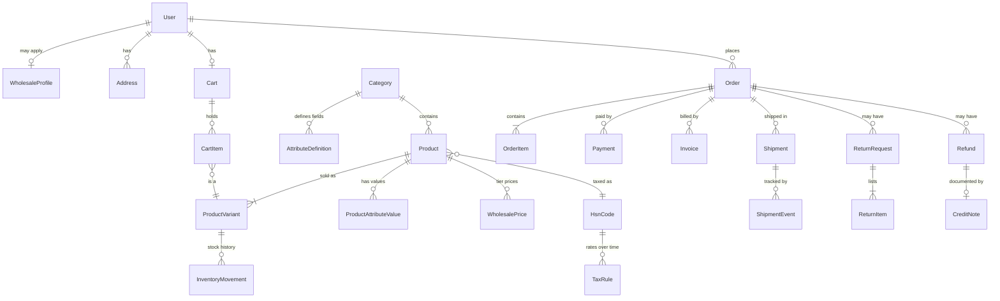

# 04 — Data model and money rules

The full schema is in [`target-schema.prisma`](./target-schema.prisma). It passes `prisma validate`, and `prisma migrate diff` turns it into clean PostgreSQL: **66 tables, 48 enums, 129 indexes, 73 foreign keys**.

## How the main pieces fit

## Rules that fix the audit findings

| Rule | Fixes |
|---|---|
| **Stock lives only on `ProductVariant`.** A plain product gets one default variant. Stock decrements with `UPDATE … WHERE stock >= qty`, plus a database `CHECK (stock >= 0)`. Every change is written to `InventoryMovement`. | H1, C3 |
| **Unpaid prepaid orders expire.** `Order.paymentDueBy` = placed + N minutes (a setting, default 30). A job cancels the order, restocks and writes the ledger. | C3 |
| **State changes are conditional updates inside a transaction** (`UPDATE … WHERE status IN (allowed)`), so a double click or two staff members can't apply the same transition twice. | H2, M18 |
| **Coupons:** `CouponRedemption` (one per order) + `UPDATE coupon SET usedCount = usedCount + 1 WHERE usedCount < usageLimit`, all in the checkout transaction. Per-user count is read inside the same transaction. Cancelling sets `releasedAt`. | H3 |
| **Human-readable numbers come from `DocumentSequence`** inside the creating transaction: orders `HF-100001`, invoices `HF/26-27/000123`, credit notes `HFCN/26-27/00012`, returns `RET-…`, refunds `RFD-…`, tickets `TKT-…`. No random numbers and no gaps. | H4 |
| **Variants are matched by id, never by SKU; ordered variants are archived, not deleted.** | H11 |
| **GSTIN change → wholesale status back to PENDING.** | H10 |
| **Phones stored as E.164 (`+919876543210`).** | M10 |
| **All dates stored in UTC, shown and entered in IST (`Asia/Kolkata`).** A coupon "ending 31 Oct" ends at 23:59:59 IST. | M3 |
| **Search** uses Postgres `pg_trgm` (typo tolerance) on titles, `searchKeywords` and the admin-editable `SearchSynonym` list (chadar → bedsheet, saari → saree, Devanagari terms), all case-insensitive. | M4 |
| **Filters come from `AttributeDefinition` / `ProductAttributeValue`.** The owner adds new filterable fields (e.g. "Thread count") in admin with no code change. | M5, owner rule |

## Money and GST

All amounts are **integers in paise**. Tax rates are **integers in basis points** (500 = 5 %).

### Retail (B2C): prices *include* GST

This is what "MRP inclusive of all taxes" means, and it's what the customer pays. **GST is extracted from the price, never added on top** (fixes C4).

For each order line:

1. `lineSubtotal = unitPrice × quantity`
2. The coupon discount is spread across eligible lines in proportion to their subtotal. Any leftover paise go to the largest lines, so the shares add up exactly.
3. `lineNet = lineSubtotal − discountAllocated` (this is what the customer pays for the line)
4. **Rate selection:** take `TaxRule` rows for the product's HSN effective on the order date. For each candidate rate *r*, compute the per-piece taxable value `lineNet ÷ quantity ÷ (1 + r)`. Pick the rule whose value band contains that number.
   - If prices sit in the overlap where neither or both rules fit, use the **higher** rate and flag the product in admin ("price falls in a GST boundary band"). **Owner's CA to confirm this treatment.**
5. `taxableValue = round(lineNet × 10000 / (10000 + rateBps))`; `tax = lineNet − taxableValue`
6. **Delivery in Rajasthan (state code 08)** → `CGST = floor(tax / 2)`, `SGST = tax − CGST`. **Elsewhere** → `IGST = tax`.

**Shipping, COD and gift-wrap fees** are taxed at the order's line rates in proportion to line values (default), or at the highest line rate. **This is a setting: CA to confirm which.**

`grandTotal = Σ lineNet + fees (+ roundOff to the nearest rupee if the setting is on)`.

### Wholesale (B2B): owner's choice

Indian wholesale prices are usually quoted "+ GST". With the setting `tax.wholesalePricesIncludeTax = false`:

`taxableValue = lineSubtotal − discount`, `tax = round(taxableValue × rateBps / 10000)`, `lineTotal = taxableValue + tax`.

The buyer's GSTIN and legal name go on the invoice so they can claim input tax credit.

### Invoices

- Issued at a configurable moment (**order confirmed** by default, or **shipped**).
- One consecutive series per financial year (resets on 1 April), ≤ 16 characters.
- Seller and buyer details are **snapshotted** onto the invoice.
- Cancelled orders before invoicing consume no number. After invoicing, a **credit note** (own series) reverses it, fully or partly.

## Migration notes (applied in Phase 2)

1. `CREATE EXTENSION IF NOT EXISTS pg_trgm;` before the first migration (needed by the title search index).
2. A custom SQL step adds `CHECK ("stock" >= 0)` on `ProductVariant`, and `CHECK ("quantity" > 0)` on `CartItem` and `OrderItem`.
3. Seed: Staff roles, the Default price tier, HSN codes (empty rates; you enter them with your CA), Settings with `OWNER_TO_CONFIRM` placeholders, the 4 launch categories with their attribute definitions, legal page drafts, notification templates, and Indian state codes and pincodes.
4. The current SQLite data is seed-only (0 orders), so no data migration is needed.

## Category attributes seeded at launch (all editable later)

| Category | Attributes (★ = filterable) |
|---|---|
| All categories | ★ Fabric · ★ Print style (Sanganeri, Bagru, Dabu, Indigo, …) · ★ Motif (buti, floral, jaal, paisley, geometric) · ★ Colour family · ★ Occasion · Dye type (natural / azo-free) |
| Kurtis | ★ Silhouette (straight, A-line, anarkali, flared) · ★ Set type (kurti only / with pant / with pant + dupatta) · ★ Length · ★ Sleeve · Neck · Lining · Pockets |
| Salwar suits | ★ Stitch type (stitched / semi / unstitched) · Top fabric + length (m) · Bottom fabric + length (m) · ★ Dupatta fabric · Dupatta length (m) |
| Sarees | ★ Saree length (m) · ★ Blouse piece (yes / no) · Blouse length (m) · Blouse stitched / unstitched · Border · Pallu |
| Bedsheets | ★ Bed size (single / double / king / super king) · Dimensions (in / cm) · ★ Thread count · GSM · ★ Pillow covers (count) · Pillow cover size · Flat / fitted · Pieces in set |
