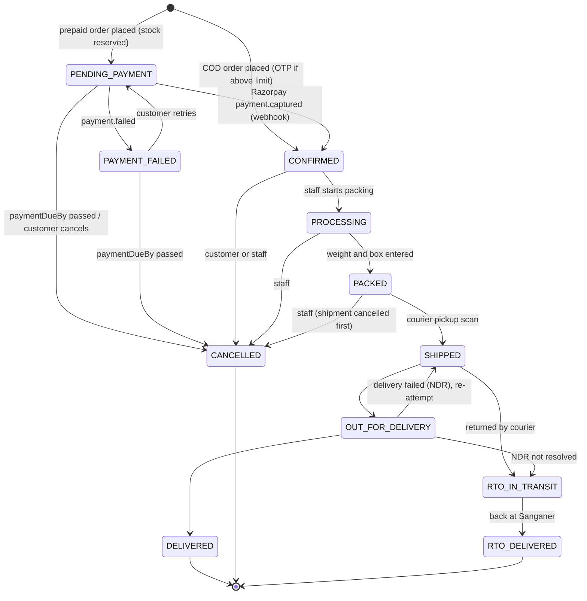
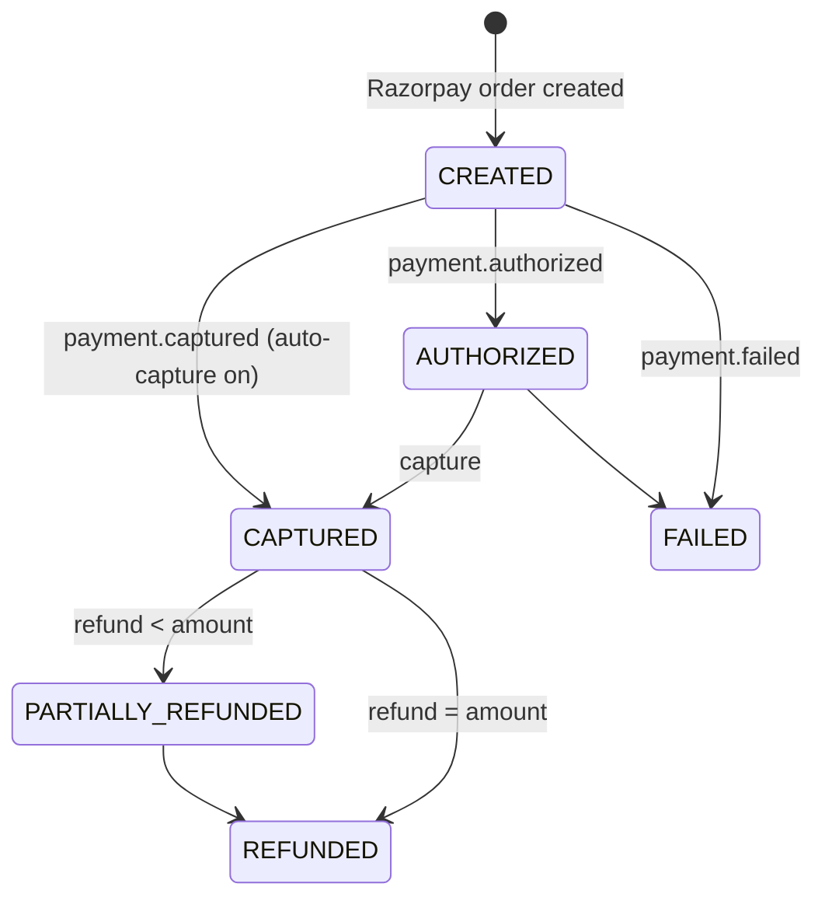
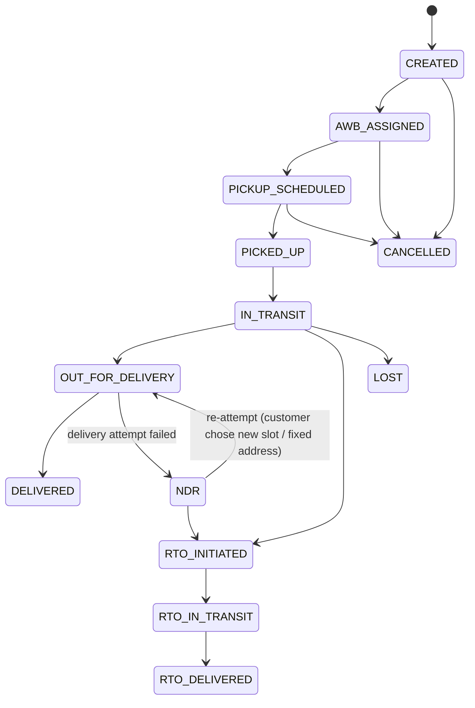
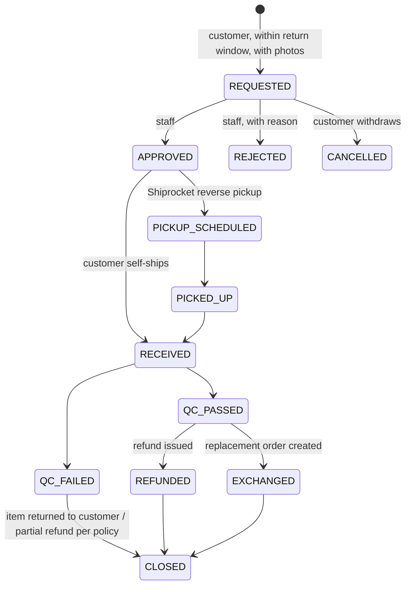
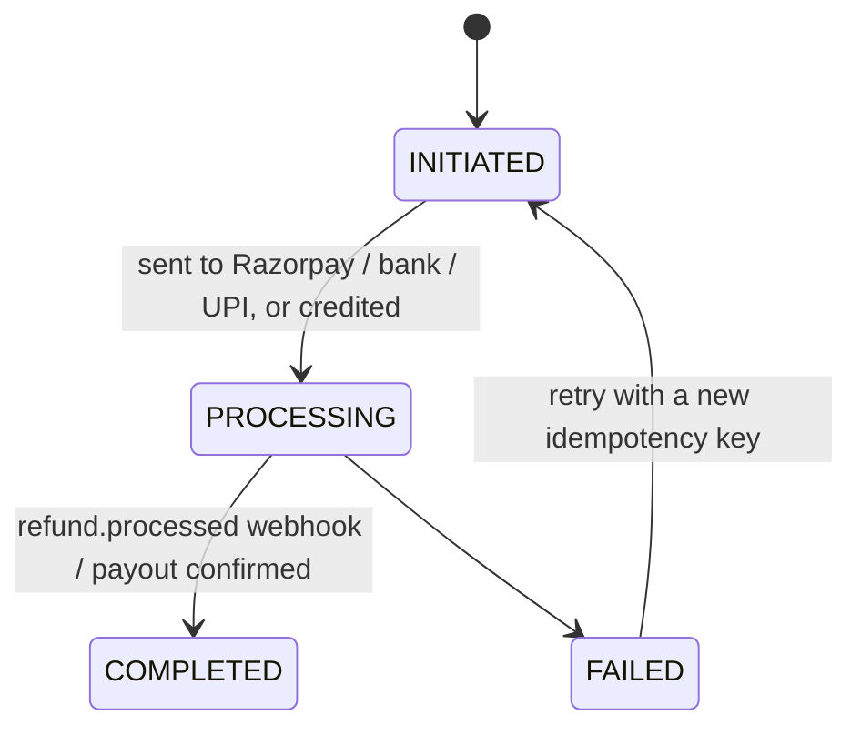
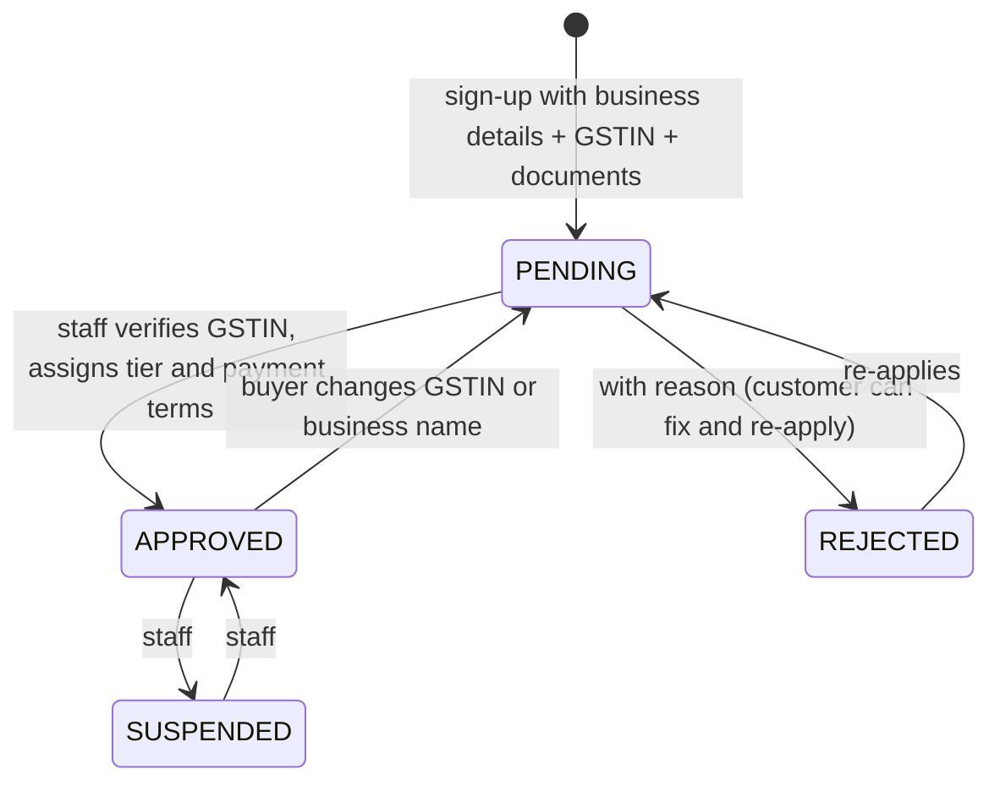

# 05 — Lifecycles (state machines)

Each lifecycle is enforced in one place in code (`src/server/*/transitions.ts`). Every transition is a conditional update inside a transaction, writes a history row, and queues the customer notification.

## 1. Order

| Transition | Who | Side effects |
|---|---|---|
| → PENDING_PAYMENT | Customer | Stock decremented (ledger `ORDER_PLACED`), coupon redeemed, Razorpay order created, `paymentDueBy` set |
| → CONFIRMED | Webhook / COD placement | Payment recorded; invoice issued (if the setting says "on confirm"); "Order confirmed" email + SMS/WhatsApp |
| → CANCELLED | Customer (before PACKED), staff, expiry job | Stock restored (ledger `ORDER_CANCELLED` / `ORDER_EXPIRED`), coupon released, prepaid → automatic full refund, credit note if invoiced, notification |
| → PACKED | Dispatch staff | Shipment created on Shiprocket → AWB, label |
| → SHIPPED / OUT_FOR_DELIVERY / DELIVERED | Shiprocket webhook (or staff manually) | Tracking timeline updated; "Shipped" message with tracking link; COD marked paid on delivery remittance |
| → RTO_DELIVERED | Webhook / staff | QC → restock; prepaid → refund (minus shipping if the policy says so — owner decides) |

Returns **don't** change the order's status. One order can have several partial returns, so they live on `ReturnRequest`. The customer's order page combines both into one timeline.

## 2. Payment (each attempt)

**The order is marked paid only by the verified webhook** (HMAC-SHA256 on the raw body, timing-safe compare, event id stored so duplicates are ignored). The browser's "success" redirect only *checks* the status. It never sets it. A daily reconciliation job compares Razorpay with the database and flags mismatches.

Order-level `paymentStatus` is calculated from all attempts and refunds: PENDING → PAID (or PARTIALLY_PAID for a wholesale advance) → PARTIALLY_REFUNDED / REFUNDED; FAILED when the last attempt failed and nothing is paid.

## 3. Shipment

Courier scans arrive by webhook, with polling every 2 hours as a fallback. Each scan is stored once (`dedupeKey`). Courier statuses map to the order status in one table in code.

## 4. Return / exchange

Stock is restored **only on QC_PASSED** (ledger `RETURN_RESTOCKED`). Items marked non-returnable in Settings or on the product can't be selected for return.

## 5. Refund

Guard rails:
- `amount ≤ amountPaid − amountRefunded`, checked inside the transaction.
- One idempotency key per attempt.
- A credit note is issued for any invoiced amount.
- Store-credit refunds complete instantly.

## 6. Wholesale application

Approval sets `User.customerType = WHOLESALE` and revokes the buyer's sessions so the new prices apply immediately. The buyer gets an email + WhatsApp message either way.

## 7. Customer-facing tracking timeline

What the customer sees on `/account/orders/{number}` and `/track`. It's merged from `OrderStatusHistory`, `ShipmentEvent`, `ReturnRequest` and `Refund`:

**Order placed → Payment received → Packed → Shipped (courier, AWB, link) → In transit (city scans) → Out for delivery → Delivered → Return requested → Pickup scheduled → Picked up → Received & checked → Refund issued (₹ amount, method, reference) → Refund credited**
